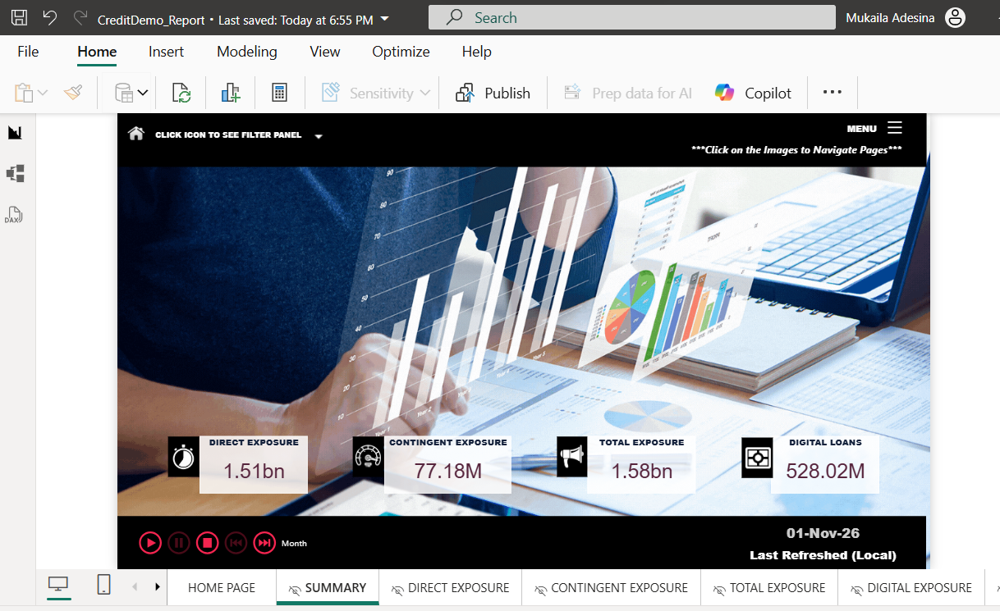
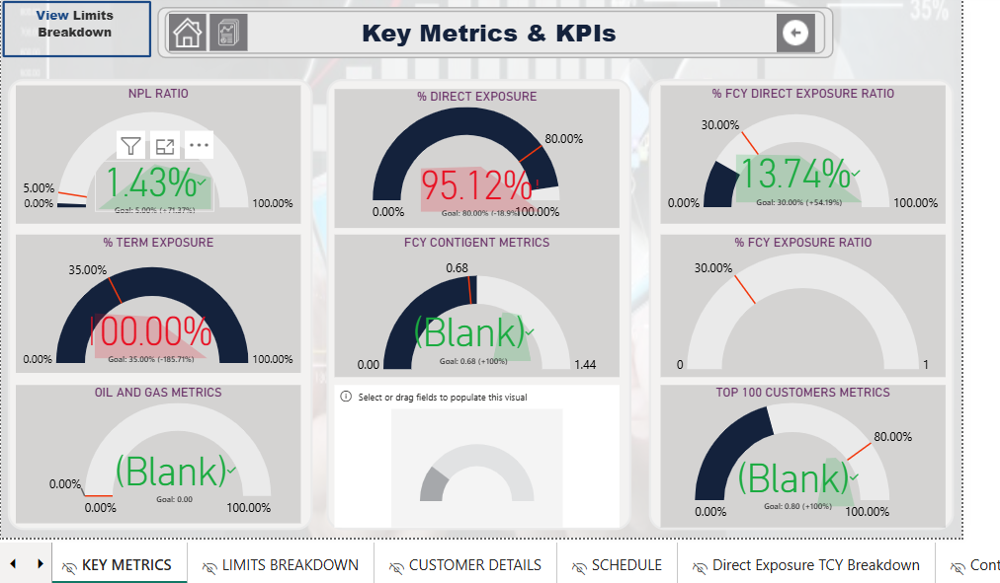

# Credit Monitoring BI Analytics | From Credit Exposure to Actionable Risk Monitoring

**SQL Server 2019 · SSAS Tabular · DAX · Power BI · Credit portfolio analytics**

> **Portfolio disclosure:** This is a demonstration using anonymised and synthetically altered banking data. Monetary amounts, dates, and some identifiers were transformed. Figures below are observations about the **demonstration dataset**, not real bank performance, recoveries, regulatory reporting, or evidence of financial losses prevented. Currency denomination has not been independently confirmed; figures are reported in local currency units (LCY).

## The business question

A headline loan balance does not tell a credit-risk team which borrowers drive concentration, whether exposures are past due, how much is unsettled, or which facilities are nearing maturity. This project consolidates credit-monitoring perspectives into a reporting workflow that can be examined and reconciled rather than relying on isolated spreadsheets or single headline KPIs.

The solution addresses eight linked questions: (1) How much exposure exists? (2) How does it change? (3) Where is it concentrated? (4) What is overdue or classified as impaired? (5) Which facilities may exceed limits? (6) What obligations remain unsettled? (7) What is nearing or past maturity? (8) What do the collections measures actually represent?

## What I implemented

- **SQL Server 2019:** a dimensional credit warehouse with reporting-date snapshots, fact and dimension tables, EDW views, and SQL-based validation and reconciliation.
- **SSAS Tabular:** a reusable semantic layer with DAX measures for direct and contingent exposure, obligations, limits, credit quality and other portfolio KPIs.
- **Power BI:** dashboard views covering summary exposure, direct exposure, limit breakdown, maturing obligations and key metrics.
- **Analytical controls:** snapshot reconciliation, customer-key matching, delinquency/classification checks, over-limit flags, obligations-component reconciliation, and collection-assumption testing.

**Reporting flow:** `SQL Server warehouse → SSAS Tabular semantic model → Power BI reports`

See [technical evidence](documentation/technical-evidence.md) and [selected DAX](documentation/selected-dax-measures.md), [dashboard analysis](documentation/dashboard-analysis.md), [business case study](documentation/business-case-study.md), and [reproducible SQL checks](sql/credit-monitoring-case-study.sql).

## November 2026 portfolio snapshot

| KPI | Validated result | Interpretation |
|---|---:|---|
| Total exposure | 1,582,246,828.01 LCY | Direct + contingent exposure |
| Direct exposure | 1,505,062,889.33 LCY | 95.12% of combined exposure |
| Contingent exposure | 77,183,938.68 LCY | 4.88% of combined exposure |
| Facility fact rows | 4,921 | Snapshot records; not necessarily distinct facilities across months |
| Distinct account keys | 3,112 | Snapshot-level count |
| Distinct customer ALT keys | 3,213 | Includes one placeholder customer key |
| Top ten customer-key concentration | ~4.67% | Individual anonymised keys; not connected groups |
| Direct exposure >90 days overdue | 326.36m LCY | Delinquency indicator, **not** official NPL ratio |
| Direct exposure with missing overdue days | 722.75m LCY | Significant reporting limitation |
| Above-limit rows | 119 | 92 direct and 27 contingent; indicative comparison |
| Past-maturity exposure | 533.97m LCY | Synthetic `DaysToMaturity` indicator |
| Unknown maturity exposure | 505.57m LCY | Requires validation against anonymised dates |

## What the analysis revealed

**Portfolio movement requires explanation, not celebration.** Total exposure fell **50.55%** from October to November 2026 (3.199bn → 1.582bn LCY). An account/type-level bridge shows 1.680bn LCY associated with combinations absent in November, 363.95m LCY associated with newly appearing combinations, and a further 301.59m LCY reduction among continuing combinations. The movement **cannot be attributed to repayments or risk reduction** without source and anonymisation lineage.

**Credit quality has material uncertainty.** 1,117 direct facility rows have overdue days >90, representing 326.36m LCY. Another 2,066 direct rows have missing overdue days. IFRS Stage 1 includes 537 rows with >90 overdue days (166.58m LCY), while 2,452 direct rows have no usable IFRS classification. These are exception flags in a synthetic dataset, not proof of real-world policy breaches.

**Limits and obligations have a traceable relationship.** 92 direct and 27 contingent rows have principal above the recorded limit. Exactly these 119 rows also account for the 11.55m LCY difference between stored unsettled totals and unsettled principal plus interest. The association is established; the underlying formula remains unverified.

**Collections look modelled, not observed.** Stored 3-, 6- and 12-month collection amounts align almost exactly with 6%, 12% and 24% of principal. These figures should be labelled **modelled collection amounts**, not cash collected.

## Why the controls matter

- A customer relationship audit found `FactFacilityDetails.CustomerALTKey → DimCustomerALT.CustomerKey` with 4,921/4,921 matching November rows and unique dimension keys; one row uses the unknown customer key `-1`.
- `FactFacilityDetails.FacilityDetailKey` matches `DimFacility.FacilityKey` for 4,921/4,921 November rows; SQL foreign-key metadata does not declare that relationship, so model/ETL semantics should still be checked.
- Missing values are treated as **unknown**, not automatically zero, performing, or current.
- Reporting-date filters prevent mixing September, October and November balances into a misleading single-period KPI.

## Decisions the reporting can support

Credit-risk and portfolio teams could use these views to prioritise investigation of unusually large exposures, review overdue facilities, triage limit exceptions, identify missing classification or maturity data, and reconcile unsettled obligations. These are **supported workflows**, not claims that any specific bank adopted recommendations or achieved a quantified benefit.

## Dashboard and implementation evidence

### Key Metrics & KPIs

This Power BI page presents gauge-style indicators for NPL ratio, direct exposure, foreign-currency exposure, term exposure, contingent exposure and top-customer metrics. It demonstrates the KPI monitoring interface, but several gauges show blank or incomplete values. The displayed NPL percentage and target markers are **not independently validated** and should not be treated as confirmed portfolio risk metrics. See the [dashboard walkthrough](documentation/dashboard-analysis.md) for interpretation and limitations.

### Other dashboard views

Additional screenshots, model evidence, and source examples are retained in `screenshots/`, `evidence/`, and `sql/`.

## Limitations and responsible publication

1. Financial amounts and dates are synthetic; trends, delinquency, maturity, impairment and collections may not preserve original business relationships.
2. The **official IFRS/prudential NPL DAX measures have not been independently reconciled**; no official NPL percentage is asserted here.
3. The impairment values appear approximately proportional to exposure; they are **not presented as verified IFRS 9 expected credit losses**.
4. Customer keys represent anonymised records, not validated connected-borrower groups.
5. No customer names, BVNs, phone numbers, emails, raw customer records, or production connection strings should be committed.
6. SQL queries are read-only and should be executed against the synthetic demo warehouse, with source column names checked before use.

**Read next:** [Detailed business analysis](documentation/business-case-study.md) · [Technical evidence](documentation/technical-evidence.md) · [Dashboard walkthrough](documentation/dashboard-analysis.md)
