# Credit Monitoring BI Analytics | From Credit Exposure to Actionable Risk Monitoring

**SQL Server 2019 · SSIS · SSAS Tabular · DAX · MDX · SSRS · Power BI · T-SQL**

> **Portfolio disclosure:** This demonstration uses anonymised and synthetically altered banking data. Amounts, dates and some identifiers were transformed. Results describe the demonstration dataset, not actual bank performance, regulatory reporting or financial savings. Amounts are in local currency units (LCY); the currency denomination has not been independently confirmed.

## 1. Introduction

When a bank lends money, it needs to know whether customers are repaying on time, how much is still outstanding and whether any loans need attention. Credit monitoring brings this information together so that management can identify potential problems early.

For example, if a customer is allowed to borrow 100,000 but owes 120,000, the customer is 20,000 above the recorded limit. A credit monitoring report makes such exceptions easier to identify.

## 2. Problem Statement

A single loan balance cannot tell management who owes the money, when it is due or whether it is at risk. This project brings those questions into one reporting solution.

| Business question | Why it matters |
|---|---|
| How much money is exposed? | Understand the size of the portfolio |
| Who accounts for the largest balances? | Monitor dependence on large borrowers |
| Which repayments are overdue? | Prioritise follow-up |
| Which facilities exceed limits? | Investigate possible unauthorised borrowing |
| Which facilities are approaching expiry? | Plan repayment or renewal |
| How much remains unpaid or is expected to be collected? | Support collections planning |

## 3. Exploratory Data Analysis (EDA)

Before interpreting a dashboard, I used SQL to understand the data and check whether the numbers agreed. I examined record counts, reporting dates, duplicate risks, missing values, customer and facility key matches, exposure movements, overdue days, limits, obligations, maturity and collections.

The November snapshot contained 4,921 facility records and 3,112 distinct account keys. All 4,921 facility rows matched a customer dimension key (including one unknown customer placeholder) and a facility dimension key. These matches establish key coverage, not proof of correct business relationships. Missing values were treated as unknown rather than zero.

## 4. Modelling

### End-to-End Solution Architecture

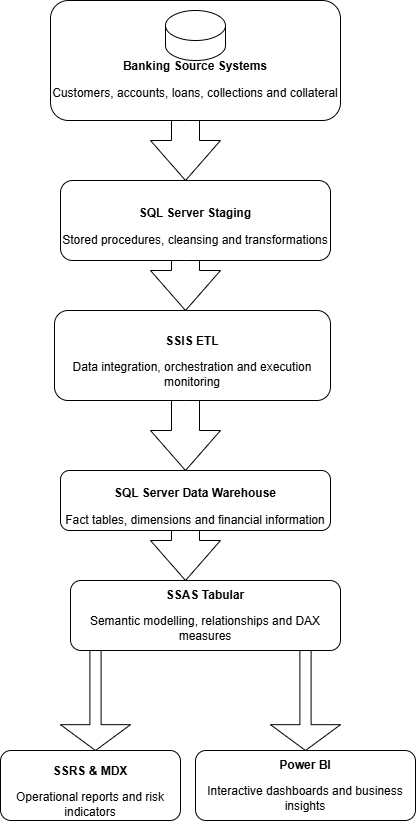

The architecture illustrates how banking source data is
processed, transformed and integrated into a central data
warehouse using SQL Server and SSIS.

SSAS Tabular provides a centralised semantic model for
financial calculations, supporting both SSRS operational
reporting and Power BI interactive dashboards.

The solution separates measurable financial information from descriptive information. This makes it possible to answer questions such as how much is owed by product, customer or month.

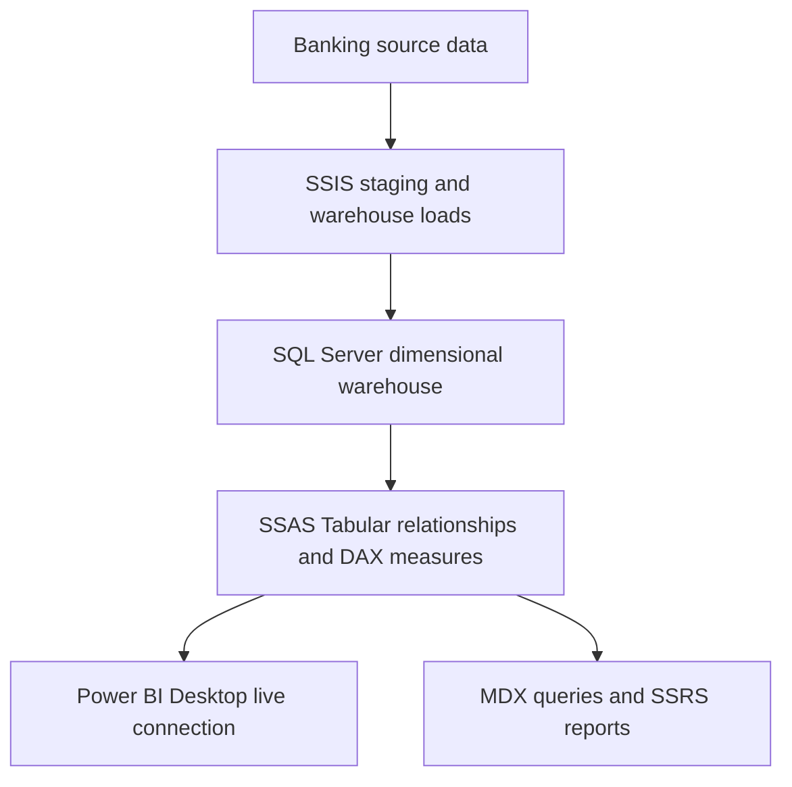

The diagram describes the broader solution architecture. The portfolio demonstrates the warehouse, model and report and their validation; it does not establish that every original ETL package was rebuilt or rerun for the demo. Power BI Service deployment is deferred.

| Table | Plain-English purpose |
|---|---|
| FactFacilityDetails | Loan exposure, balances, limits and repayment indicators |
| FactCollections | Collection amounts and ratios |
| FactAccountSummary | Account balances |
| DimCustomerALT | Who the customer is |
| DimFacility | Facility details and risk classifications |
| DimAccount | Account information |
| DimExposureType | Whether exposure is direct or contingent |
| DimDate | When the information applies |

A reporting snapshot is a picture of the portfolio at a particular date. Balances from different months should not be added together as if they were a single month's balance. SSAS Tabular centralises relationships and reusable business calculations so reports can use consistent definitions.

## 5. SQL Logic

**Total exposure by month:** add exposure amounts within each reporting period.

```sql
SELECT ProcessingDateKey, SUM(TotalExposureLCY) AS TotalExposure
FROM dbo.FactFacilityDetails
GROUP BY ProcessingDateKey
ORDER BY ProcessingDateKey;
```

**Above-limit records:** compare outstanding principal with the recorded limit.

```sql
SELECT FacilityDetailKey, [Limit], PrincipalOutstandingBalLCY,
       PrincipalOutstandingBalLCY - [Limit] AS ExcessAmount
FROM dbo.FactFacilityDetails
WHERE ProcessingDateKey = 20261101
  AND PrincipalOutstandingBalLCY > [Limit];
```

**Overdue exposure:** identify balances associated with obligations overdue by more than 90 days. This is not an official NPL calculation.

```sql
SELECT COUNT(*) AS FacilityRows, SUM(TotalExposureLCY) AS Exposure
FROM dbo.FactFacilityDetails
WHERE ProcessingDateKey = 20261101 AND UnpoDaysOverdue > 90;
```

**Unpaid obligations:** compare the stored total with its principal and interest components.

```sql
SELECT FacilityDetailKey,
       TotalUnsettledAmountLCY - UnsettledPrincipalAmount
       - UnsettledInterestAmount AS Difference
FROM dbo.FactFacilityDetails
WHERE ProcessingDateKey = 20261101;
```

**Maturity:** classify records by days remaining; negative means past maturity, NULL means unknown.

```sql
SELECT CASE WHEN DaysToMaturity IS NULL THEN 'Unknown'
            WHEN DaysToMaturity < 0 THEN 'Past maturity'
            WHEN DaysToMaturity <= 30 THEN '0-30 days'
            WHEN DaysToMaturity <= 90 THEN '31-90 days'
            ELSE 'Over 90 days' END AS MaturityBand,
       SUM(TotalExposureLCY) AS Exposure
FROM dbo.FactFacilityDetails
WHERE ProcessingDateKey = 20261101
GROUP BY CASE WHEN DaysToMaturity IS NULL THEN 'Unknown'
              WHEN DaysToMaturity < 0 THEN 'Past maturity'
              WHEN DaysToMaturity <= 30 THEN '0-30 days'
              WHEN DaysToMaturity <= 90 THEN '31-90 days'
              ELSE 'Over 90 days' END;
```

More examples: [SQL analysis](sql/credit-monitoring-case-study.sql), [KPI reconciliation](sql/kpi-reconciliation.sql), [illustrative dimension load](sql/dimension-load-example.sql), [selected DAX measures](documentation/selected-dax-measures.md).

## 6. Skills/concepts demonstrated

| Skill | Application |
|---|---|
| SQL Server and T-SQL | Joins, aggregation, CTEs, CASE, window functions and reconciliation |
| SSIS / ETL | Staging, audit steps, key checks and dimension loading design |
| Dimensional modelling | Facts, dimensions, reporting grain and snapshots |
| SSAS Tabular and DAX | Reusable measures and model relationships |
| MDX and SSRS | Parameterised analytical queries and operational report datasets |
| Power BI | Cards, charts, gauges, tables, filters and report navigation |
| Data analysis and quality | Missing values, exceptions, trend analysis and validation |
| Data governance and Git | Anonymisation, curated evidence, documentation and version control |

## 7. Technical Documentation

### 7.1 SQL Server — warehouse and validation

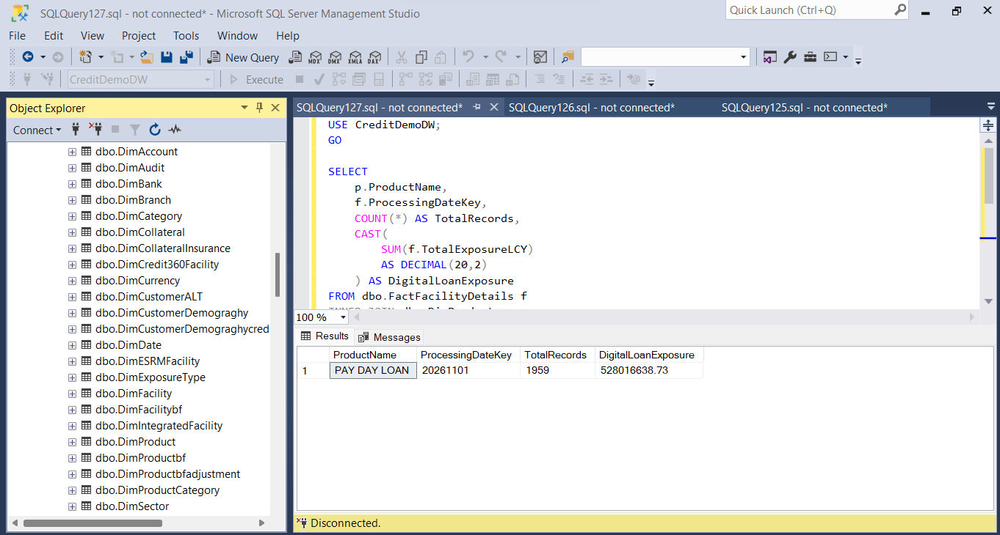

The left side shows warehouse tables; the query and result on the right demonstrate how SQL checks a report figure. The PAY DAY LOAN product returned 1,959 records and 528,016,638.73 LCY on 1 November 2026, matching the rounded digital-loan card of 528.02m. This checks the selected product, not necessarily all digital lending.

### 7.2 SSIS — ETL staging

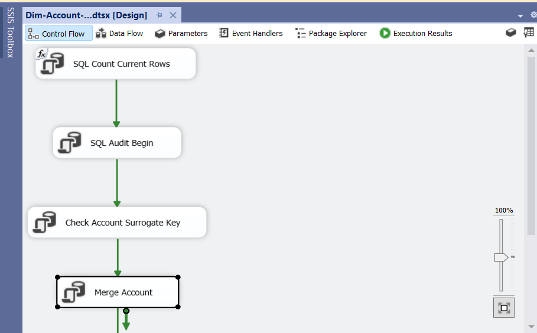

ETL means extract, transform and load: collect data, prepare it and place it in the warehouse. The screenshot shows a control flow that counts existing rows, starts an audit, checks account surrogate keys (internal identifiers) and merges account information. The image is design evidence, not a successful execution log.

### 7.3 SSIS — warehouse loading

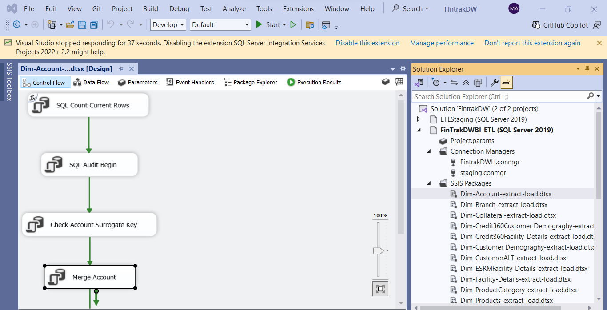

The warehouse package design illustrates how loading tasks are organised. Keeping staging and warehouse loading separate helps manage dependencies and investigate failures. The public repository contains a sanitised illustrative SQL load, not the full production package.

### 7.4 SSAS Tabular — model tables

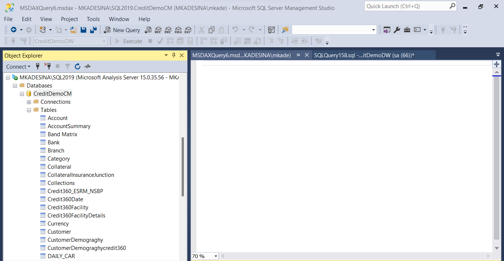

The semantic model makes warehouse information available to report authors in a reusable structure.

### 7.5 SSAS Tabular — relationships


Relationships allow financial balances to be analysed by customer, product, branch and date. The screenshot shows model relationship definitions; exact filter direction and business semantics require model-level verification.

### 7.6 DAX — business measures


DAX is the calculation language used to define reusable indicators such as total exposure and unpaid obligations. Centralising these calculations helps avoid different reports using different definitions. Not every existing measure has been independently validated.

### 7.7 Stored procedures — how the data is prepared and reported

A stored procedure is a saved set of database instructions. Instead of manually repeating the same tasks every day, the team can run a named procedure to prepare data or retrieve a report. The following inventory describes 18 reviewed definitions from the original solution. It does not imply that every procedure was executed in this demonstration or authored solely by the portfolio owner.

| Area | Procedure | What it does in everyday language |
|---|---|---|
| Staging | `load_stg_facility_pre_upld` | Reload selected dates and standardise uploaded facility fields. |
| Staging | `load_RiskAssetPre` | Prepare risk asset records for the latest processing date. |
| Staging | `load_stg_Collections_pre` | Prepare collections using intermediate tables. |
| Staging | `LoadLimitDefinition` | Import limit definitions from Excel. |
| Warehouse | `LoadDimAccount` | Clean and merge account attributes. |
| Warehouse | `LoadDimCustomerALT` | Maintain customer attributes. |
| Warehouse | `LoadDimFacility` | Maintain facility attributes. |
| Warehouse | `load_CollateralInsuranceJunction` | Rebuild collateral and insurance associations. |
| Orchestration | `ExecutePackage_DWBI` | Start and monitor SSIS catalog executions. |
| Orchestration | `facility_details_pre` | Run staging and dimension refresh steps in sequence. |
| Orchestration | `load_RefreshRundate_Status_post` | Update completion timestamps and status. |
| Validation preparation | `facilityDetails_DQ` | Extract recent facility records for review; not a complete testing framework. |
| Reporting | `CreditRiskMonitoring_ReportVtotal` | Retrieve parameterised credit risk information from Analysis Services. |
| Reporting | `LIMIT_ALERT` | Prepare sector exposure and limit reporting. |
| Reporting | `UNPAID_OBLIGATION_REPORT` | Retrieve outstanding obligation measures by reporting context. |
| Reporting | `load_digital_loan_product_` | Aggregate digital lending indicators by product and date. |
| SSRS / MDX | `KEYMETRICS` | Retrieve KPI measures and targets for a selected date. |
| SSRS / MDX | `Load_AlertTable` | Retrieve risk indicators by date and organisational context. |

### 7.8 MDX and SSRS — operational reporting

MDX (Multidimensional Expressions) retrieves measures from Analysis Services. SSRS (SQL Server Reporting Services) uses report datasets to present structured operational reports. The reviewed KEYMETRICS and Load_AlertTable procedures use analytical queries to retrieve indicators for a selected reporting context. Power BI uses the Tabular model for interactive analysis, while SSRS provides structured reporting. No SSRS report rendering or deployment has been independently verified in this demo.

### 7.9 Representative SQL implementation examples

[Eight independently rewritten SQL/MDX examples](sql/stored-procedures/README.md) illustrate the patterns found in the reviewed procedures. They use fictional schemas and data contracts rather than reproducing proprietary code. They are teaching examples, not tested replacements for the original procedures. Original source definitions, server names, file paths and personal-information fields are excluded.

Technical improvements include validating source uniqueness before dimension upserts, protecting reloads with transactions, reviewing constraint validation, removing unnecessary fixed delays, and validating SSIS execution status and report parameters. Publication of original code requires permission.

## 8. Report / Dashboard and Findings

### Visualization and report flow

Home → Summary → Direct exposure → Contingent exposure → Total exposure → Digital exposure → Unpaid obligations → Maturing obligations → Key metrics → Limits breakdown → Customer details / Schedule.

Cards show headline numbers; bar charts compare categories; trend charts compare months; doughnut charts show shares of a total; gauges compare a measure with a target; tables support detailed review. Screenshots may use different filter contexts, so their headline figures must not be compared without checking dates and filters. Blank means unavailable or not applicable, not necessarily zero.

### 8.1 Home page


The entry page introduces the report and provides a starting point for navigating the credit-monitoring views.

### 8.2 Portfolio summary and overview


| Card | Meaning | November result |
|---|---|---:|
| Direct exposure | Funded credit exposure, such as loans | 1.505bn |
| Contingent exposure | Potential commitments, such as guarantees | 77.18m |
| Total exposure | Direct plus contingent | 1.582bn |
| Digital loans | Exposure for the selected PAY DAY LOAN product | 528.02m |

The SQL totals reconcile to the displayed cards after rounding. Outstanding principal was 1.561bn. Direct exposure represents 95.12% of combined exposure. This page answers the first management question: how large is the portfolio?

### 8.3 Direct exposure

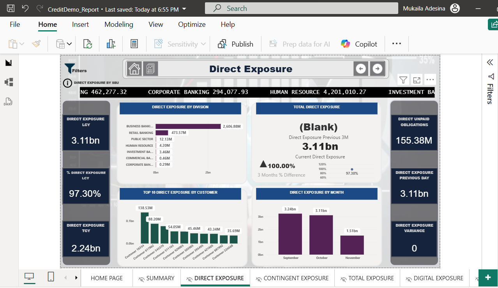

| Visual | What it tells us |
|---|---|
| Exposure by division | Which business units account for the largest funded balances; business banking leads in this view |
| Top 10 customers | Which customer records contribute the largest balances in the selected context |
| Exposure by month | September 3.24bn, October 3.11bn, November 1.51bn |
| Current and previous three months | Intended to compare periods; previous value is blank, so the displayed change is not reliable |
| Side cards | Exposure, currency-related amounts, unpaid obligations and previous-day comparisons |

**Finding:** The 3.11bn headline corresponds to the October SQL total at rounding precision, not the November summary. Investigate the large monthly movement before attributing it to repayment.

### 8.4 Contingent exposure

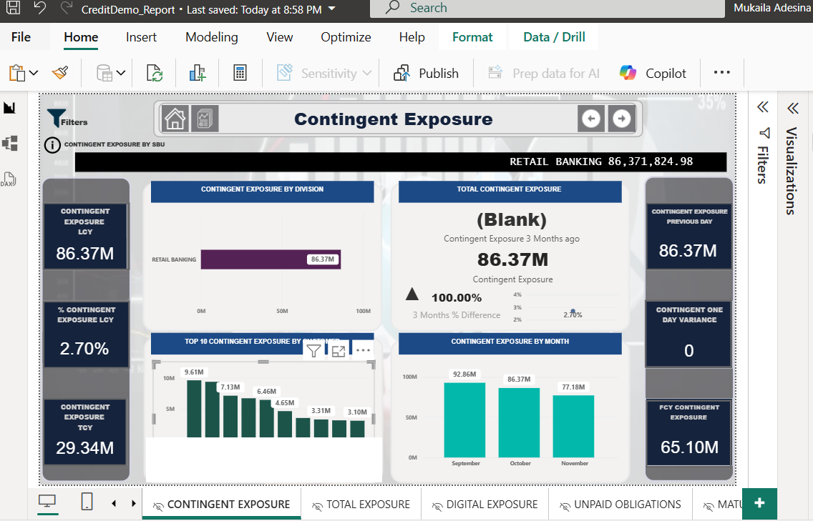

| Visual | What it tells us |
|---|---|
| Division bar | Retail banking is the displayed division with 86.37m |
| Top 10 customer bars | Largest contingent commitments in this view (customer labels withheld) |
| Monthly bars | 92.86m in September, 86.37m in October and 77.18m in November |
| Three-month comparison | Prior value is blank; percentage change needs validation |
| Side cards | Current and previous-day exposure, variance and currency-related indicators |

**Finding:** Contingent exposure is smaller than direct exposure but still represents potential obligations. The 86.37m headline aligns with October, not November.

### 8.5 Total exposure

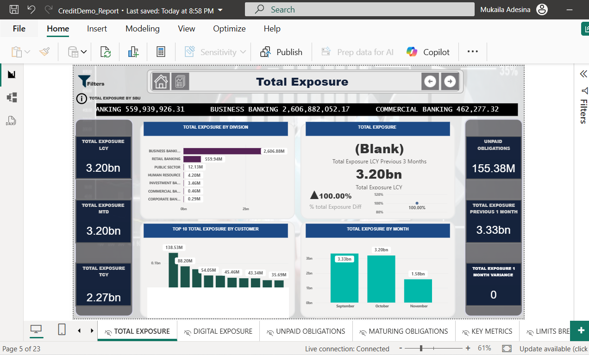

| Visual | What it tells us |
|---|---|
| Division bars | Business banking is the largest displayed contributor |
| Top 10 customer bars | Largest exposures in the selected context (customer labels withheld) |
| Monthly bars | Combined exposure moves from 3.33bn to 3.20bn to 1.58bn |
| Period comparison | Previous three-month amount is blank; do not interpret the change as verified |
| Side cards | Current, month-to-date, previous-month and unpaid amounts; variance needs checking |

**Finding:** SQL confirms a 50.55% fall from October to November. Most of the fall relates to account/type combinations absent in November; this is not evidence of actual repayments. November's top ten anonymised customer keys account for about 4.67% of exposure; connected borrower groups were not validated.

### 8.6 Digital exposure

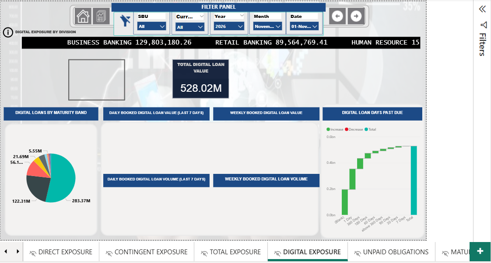

| Visual | What it tells us |
|---|---|
| Total digital loan value | 528.02m in the selected context, matching the rounded PAY DAY LOAN SQL result |
| Division ticker | Business banking shows 129.80m and retail banking 89.56m; the remaining ticker is clipped |
| Maturity pie | Largest visible slices are 283.37m and 122.31m; band labels are not visible, so their maturity periods cannot be assigned |
| Days past due waterfall | Shows contributions from overdue categories, including a blank category; the rising bars are not a time trend |
| Daily and weekly booked value and volume | Blank visuals; no booking trend or zero activity can be inferred |

**Finding:** The page helps management investigate digital lending size, maturity and overdue status. Validate missing bands and booking data before drawing conclusions about repayment or growth.

### 8.7 Unpaid obligations

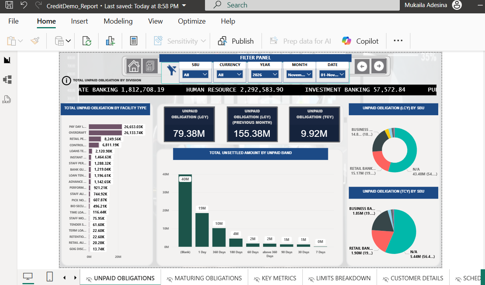

| Visual | What it tells us |
|---|---|
| Facility type bars | Which products contribute most to unpaid amounts; PAY DAY LOAN and overdraft lead in this view |
| Unpaid band bars | How unsettled amounts are distributed across overdue categories; the blank band is substantial |
| LCY and TCY doughnuts by business unit | How unpaid amounts are distributed across divisions in the displayed currency measures; N/A is a large category |
| Cards | 79.38m current, 155.38m previous month and 9.92m in the TCY measure |

**Finding:** SQL confirms 79.38m stored unsettled obligations in November. An 11.55m difference from principal plus interest occurs in exactly the 119 above-limit rows. The underlying formula is not yet confirmed. Currency conversions and band definitions need validation.

### 8.8 Maturing obligations

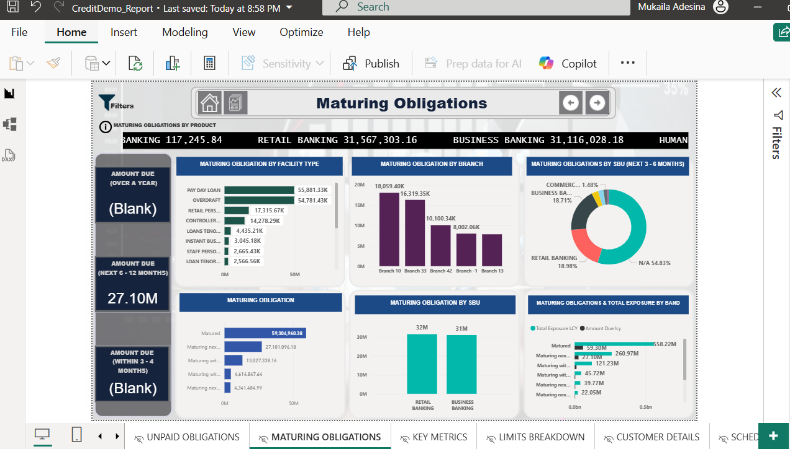

Maturity is the date a facility is due to end or be repaid under its agreement.

| Visual | What it tells us |
|---|---|
| Facility type bars | Which products contribute most to maturing amounts |
| Branch bars | Which branches have larger amounts requiring attention |
| Business-unit doughnut (next 3–6 months) | Distribution of upcoming obligations; N/A is 54.83% in this view |
| Maturing obligation bars | Amount due by maturity band, including 59.30m in the matured band |
| Business-unit bars | Retail and business banking show roughly 32m and 31m |
| Exposure versus amount due by band | Distinguishes overall exposure from the smaller amount due |
| Side cards | 27.10m due in the next 6–12 months; other displayed periods are blank |

**Finding from separate November SQL analysis:** 533.97m exposure is recorded past maturity, 134.38m within 90 days and 505.57m has unknown maturity. These use `DaysToMaturity` and are not the same as the screenshot's amount-due figures or necessarily its filter context. Synthetic dates require validation; past maturity does not automatically mean default.

### 8.9 Key Metrics & KPIs


| Gauge | Plain-English interpretation |
|---|---|
| NPL ratio | Share classified as non-performing; displayed 1.43% is not independently validated |
| Direct exposure | Share of combined exposure; 95.12% agrees with November SQL |
| FCY direct exposure | Foreign-currency direct exposure share; displayed 13.74%, denominator unverified |
| Term exposure | Share attributed to term facilities; displayed 100%, definition unverified |
| FCY contingent metrics | Foreign-currency contingent indicator; blank |
| FCY exposure ratio | Overall foreign-currency exposure indicator; no confirmed value |
| Oil and gas metrics | Sector-specific monitoring indicator; blank |
| Top 100 customers | Concentration indicator; blank |
| Unconfigured visual | No fields assigned; not a KPI result |

Target markers and colours illustrate monitoring design, not confirmed bank policy or proof of compliance. A blank gauge must not be treated as a successful result.

### 8.10 Limits breakdown

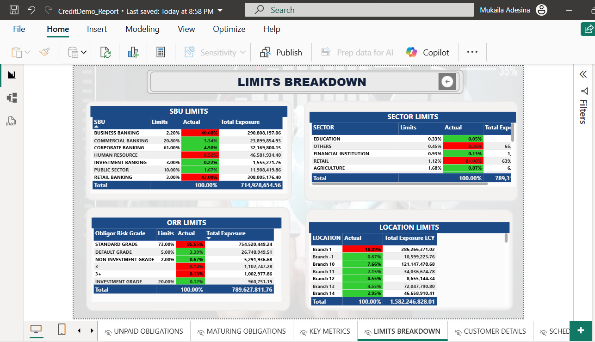

| Table | What it tells us |
|---|---|
| SBU limits | Compares business-unit shares with displayed limits; retail and business banking are highlighted red |
| Sector limits | Compares sector shares with displayed limits; retail shows 81% against 1.12% in this view |
| ORR limits | Compares borrower risk-grade shares with displayed limits |
| Location limits | Shows exposure distribution by branch; Branch 1 has 18.09% |

**Finding:** Separate SQL checks identify 92 direct and 27 contingent facility rows above their recorded individual limits, with indicative combined excess of 186.88m. These are different from the dashboard's group concentration limits. Table totals differ by grouping, so denominators and formatting rules need verification before declaring breaches.

### 8.11 Customer details and repayment schedule

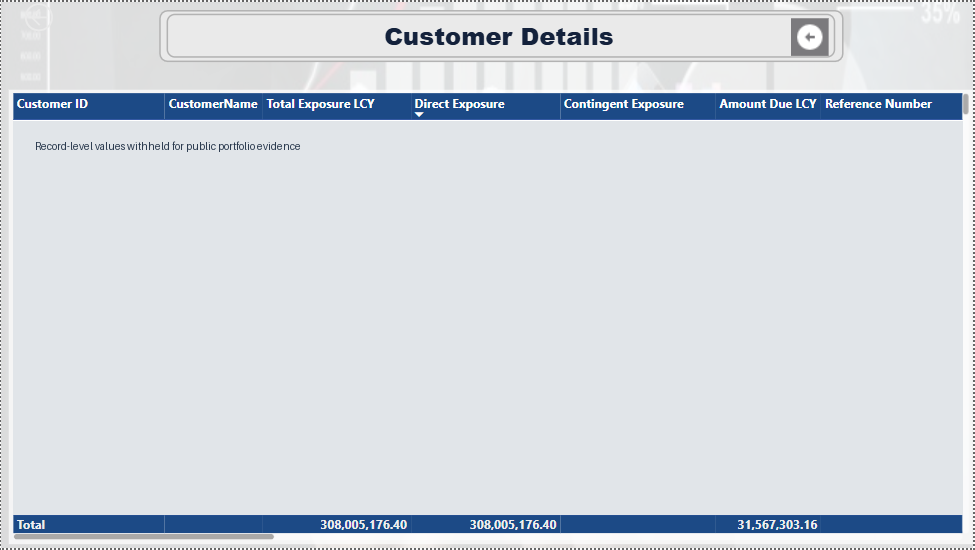

The table brings together customer identifiers, total exposure, direct and contingent exposure, amount due and facility reference. Its displayed total is 308.01m exposure and 31.57m due. This is the displayed report context, not the full November portfolio. The visible rows help staff identify larger balances for follow-up.

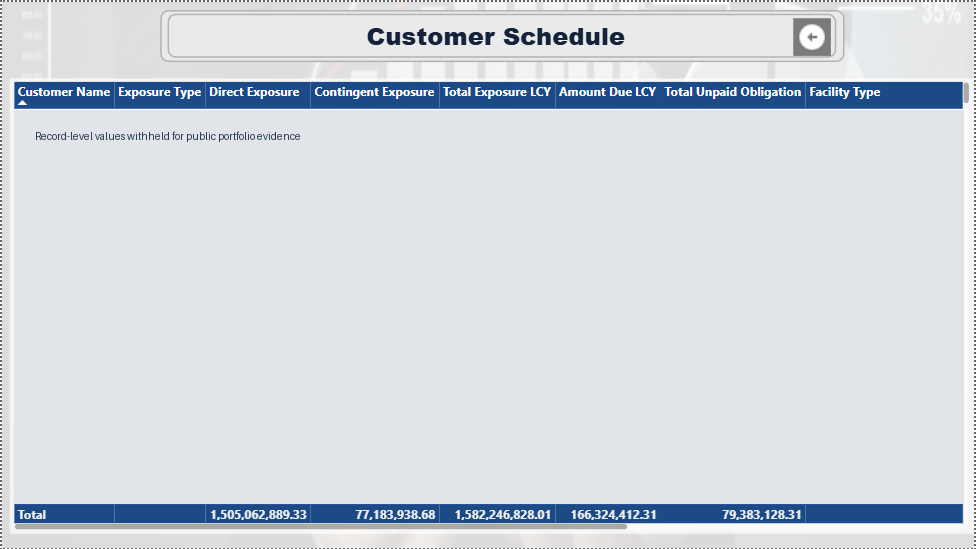

The schedule table shows customer-level facility types, exposure, amounts due and unpaid obligations. The totals show 1.58bn exposure, 166.32m amount due and 79.38m unpaid obligations. Exposure and stored unsettled totals agree with the November SQL checks; the displayed amount due differs from the raw SQL AmountDue sum of 142.11m, so the measure definition and currency conversion require reconciliation. Customer -1 denotes an unknown customer, not a real named borrower. The visible table does not establish future instalment dates.

**Finding:** These pages support investigation from portfolio totals down to individual facilities. For public evidence, record-level identifiers and amounts have been obscured as an extra precaution; aggregate totals remain visible. Confirm publication permission before release.

### 8.12 Additional findings from SQL analysis

| Finding | Business meaning |
|---|---|
| 326.36m direct exposure recorded more than 90 days overdue | Prioritise review; this is not an official NPL ratio |
| 722.75m direct exposure has unknown overdue days | Missing data prevents a complete assessment |
| 166.58m Stage 1 exposure recorded over 90 days overdue | Investigate classification rules and synthetic data consistency |
| Impairment appears roughly proportional to exposure | Do not treat it as independently verified IFRS 9 expected credit loss |
| Collections align with fixed 6%, 12% and 24% rates for 3, 6 and 12 months | Treat 99.73m, 199.46m and 398.92m as modelled amounts, not actual recoveries |
| Collections principal differs from facility principal by 101.35m | Compare populations and reporting grain before expecting reconciliation |

## 9. Recommendations

| Recommended action | Why it matters |
|---|---|
| Investigate the 119 above-limit records | Determine whether the excess is authorised and understand the obligation difference |
| Review overdue and missing-status records | Improve the reliability of repayment monitoring |
| Correct and validate maturity information | Plan renewals and repayments using reliable dates |
| Validate IFRS, NPL and impairment rules | Avoid misleading credit-risk or regulatory conclusions |
| Investigate monthly portfolio movements | Distinguish genuine changes from missing records or synthetic transformations |
| Separate actual collections from modelled collections | Measure recovery performance accurately |
| Automate reconciliation and exception alerts | Detect data problems and potential risks earlier |
| Deploy to Power BI Service in future | Improve accessibility; live local SSAS requires connectivity such as a gateway |

## Conclusion

This project demonstrates how SQL, a dimensional warehouse, SSAS Tabular, SSRS and Power BI can turn complex lending information into understandable management reports. Its value is not simply displaying numbers: it helps identify questions that need investigation and supports better-informed decisions. The demonstration does not establish actual financial savings, regulatory compliance or realised recoveries.

**Further reading:** [Detailed business case study](documentation/business-case-study.md) · [Dashboard analysis](documentation/dashboard-analysis.md) · [Technical evidence](documentation/technical-evidence.md). The existing supporting documents describe the earlier curated screenshot selection; this README expands that selection. Review all screenshots and SQL for confidentiality and publication rights before publishing updates.
