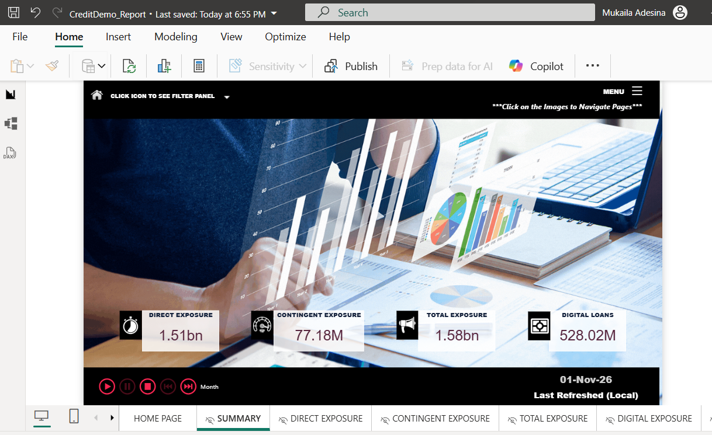
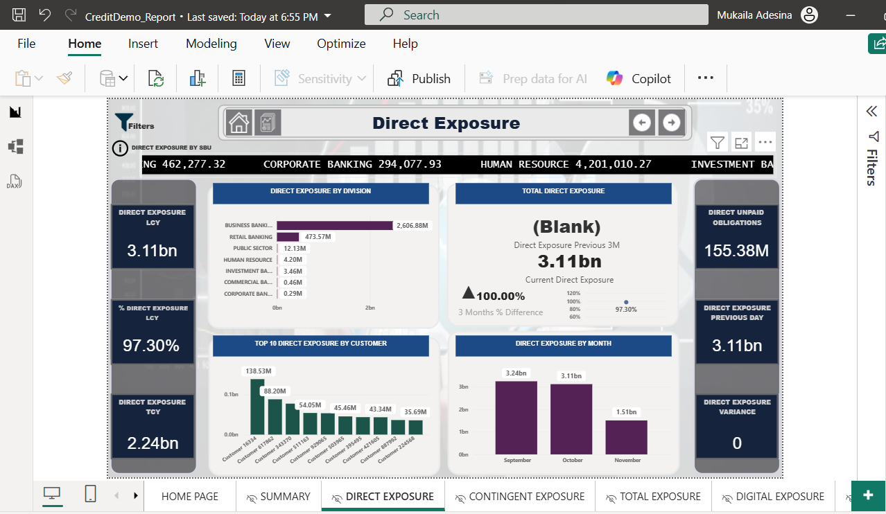
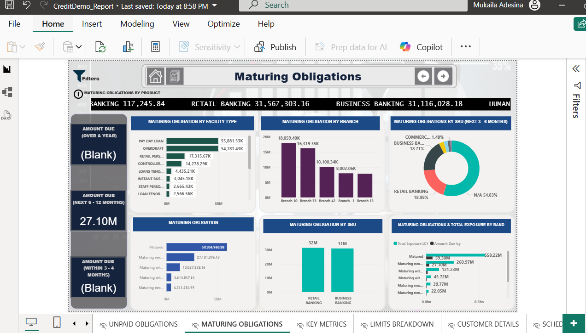
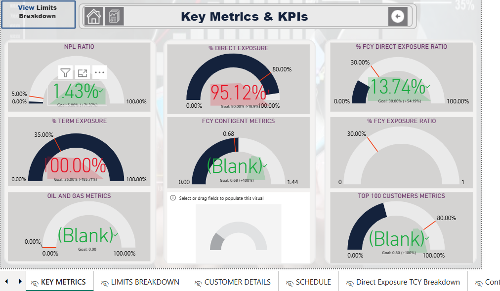
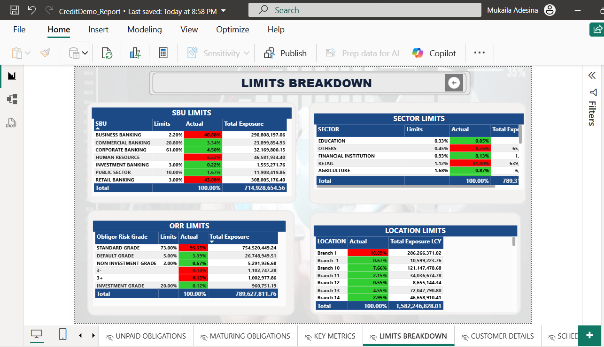

# Dashboard & Reports Analysis

[← Back to project README](../README.md)

## Purpose and reading guide

This page expands on the individual Power BI pages captured in the portfolio. **Observations** describe visible dashboard elements; **business interpretation** explains how they could support credit monitoring. Some visuals show **(Blank)** or incomplete data; those are documented rather than treated as valid zero values.

## 1. Credit Monitoring summary

**What is shown:** A landing summary with date and business filters, navigation controls, and headline cards for direct exposure, contingent exposure, total exposure and digital loans.

**Selected context in the screenshot:** 1 November 2026. The headline cards show **1.51bn**, **77.18M**, **1.58bn**, and **528.02M**, respectively.

**Business interpretation:** A consolidated snapshot helps users distinguish funded/direct exposure from contingent commitments and identify the digital-lending portion of the portfolio. The sum of direct and contingent exposure matches total exposure at the displayed precision.

## 2. Direct exposure

**What is shown:** Direct exposure by division, summary cards, category/product breakdowns and charts comparing portions of the portfolio.

**Business interpretation:** Supports identification of where funded credit risk is concentrated and which business divisions or products contribute most. Ratios shown in the dashboard should be checked against their underlying measure definitions before being described as risk thresholds.

## 3. Contingent exposure

*Additional report reviewed; screenshot not included in the curated public selection.*

**What is shown:** Contingent exposure indicators, breakdown charts and a division summary.

**Business interpretation:** Helps distinguish contingent commitments from directly outstanding balances. A displayed **(Blank)** indicates missing or nonapplicable data in that visual context, not automatically a zero balance.

## 4. Total exposure

*Additional report reviewed; screenshot not included in the curated public selection.*

**What is shown:** A consolidated exposure page with headline amounts and distribution visuals.

**Business interpretation:** Brings funded and contingent exposure together for overall credit portfolio monitoring. The screenshot contains figures from its own filter context; avoid comparing them to the summary card unless the selected filters are identical.

## 5. Digital exposure / digital loans

The Digital Exposure page was reviewed in Power BI during validation, but a standalone PNG for it is **not included in this ZIP**. The summary screenshot shows **528.02M** for Digital Loans.

**Confirmed report mapping:** The selected card uses **`FacilityDetails[Total Exposure LCY]`** and a page filter **`ProductName = PAY DAY LOAN`**. The SQL query for `ProcessingDateKey = 20261101` returned **1,959 records** and **528,016,638.73**, agreeing with the card after rounding.

**Business interpretation:** This filtered view isolates a specific digital-loan product for portfolio monitoring. It should not be presented as all digital lending unless the product taxonomy supports that interpretation.

## 6. Unpaid obligations

*Additional report reviewed; screenshot not included in the curated public selection.*

**What is shown:** Outstanding obligation amounts, ageing or overdue bands, and distribution charts.

**Business interpretation:** Can help operations prioritise follow-up and understand the distribution of unpaid amounts. Interpretation of delinquency bands requires confirmation of the report's underlying definitions and calculation dates.

## 7. Maturing obligations

**What is shown:** Maturity-related cards and distributions by band or category.

**Business interpretation:** Can support upcoming repayment planning and identification of concentrations of near-term maturities. Some cards show **(Blank)** and should not be interpreted as zero without further validation.

## 8. Key metrics & KPIs

**What is shown:** Gauge-style KPI visuals with percentages and target/benchmark markers.

**Business interpretation:** Intended as an at-a-glance performance and risk monitoring page. KPI titles, denominators, target definitions and business thresholds must be checked before assigning positive or negative meaning to a particular percentage. Several indicators appear blank or at zero in the screenshot.

## 9. Limits breakdown

**What is shown:** Tables comparing credit limits across business, sector and location groupings, with colour-coded cells.

**Business interpretation:** Can highlight concentrations and limit utilisation. Colours alone do not establish a breach; interpretation requires the precise measure, limit basis and conditional-formatting rules.

## 10. Customer details

*Additional report reviewed; screenshot not included in the curated public selection.*

**What is shown:** Customer-level tabular reporting with customer identifiers and financial fields.

**Business interpretation:** Enables drill-down from aggregate exposures to individual records, subject to access controls.

**Publication caution:** Customer-level screenshots are higher risk. Publish only after verifying all names, identifiers, accounts and other record-level fields are synthetic or irreversibly masked. Consider excluding this image from the public repository.

## 11. Customer schedule

*Additional report reviewed; screenshot not included in the curated public selection.*

**What is shown:** A detailed schedule table with customer and facility-related financial values.

**Business interpretation:** Supports operational review of repayment or facility schedules. Exact column definitions and calculation rules should be verified before making stronger claims.

**Publication caution:** Treat this as record-level information and withhold until privacy review is complete.

## Validation summary

For **1 November 2026**, SQL Server returned:

| KPI | SQL value | Dashboard label |
|---|---:|---:|
| Direct exposure (ExposureTypeKey 1) | 1,505,062,889.33 | 1.51bn |
| Contingent exposure (ExposureTypeKey 2) | 77,183,938.68 | 77.18M |
| Total exposure (types 1 + 2) | 1,582,246,828.01 | 1.58bn |
| PAY DAY LOAN exposure | 528,016,638.73 | 528.02M |

The first three values came from `dbo.FactFacilityDetails` grouped by `ExposureTypeKey`; the digital-loan figure came from the same fact table joined to `dbo.DimProduct` and filtered by product. Values reconcile **at displayed rounding precision**; the semantic-model DAX and all other report pages have not been independently audited.

## Caveats before publishing

- Some screenshots visibly contain blank visuals and record-level tables.
- The ZIP did not contain a standalone Digital Exposure screenshot, SSAS model diagram or SQL result screenshot.
- Screenshot images show the Power BI editing interface; clean presentation-mode captures would improve readability.
- The reconciliation establishes numerical consistency, not proof that all underlying data is synthetic or de-identified.
