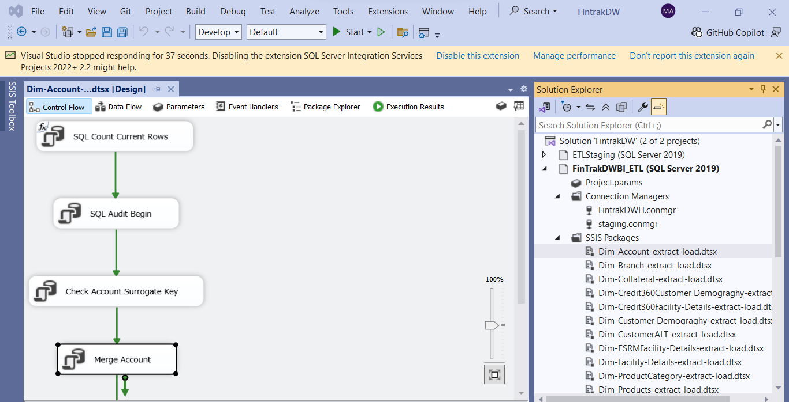
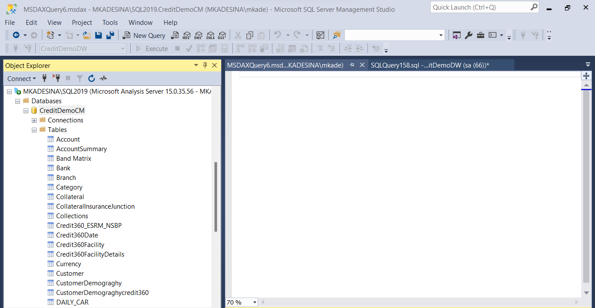
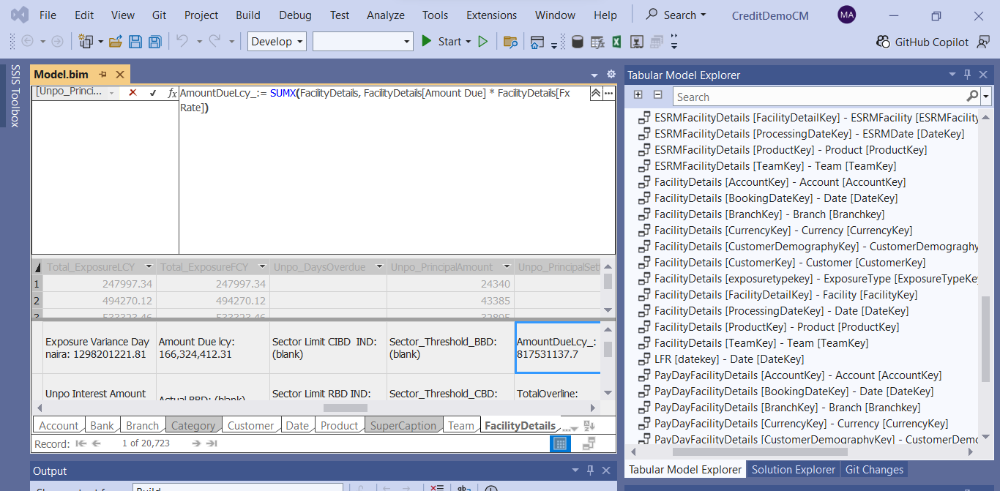
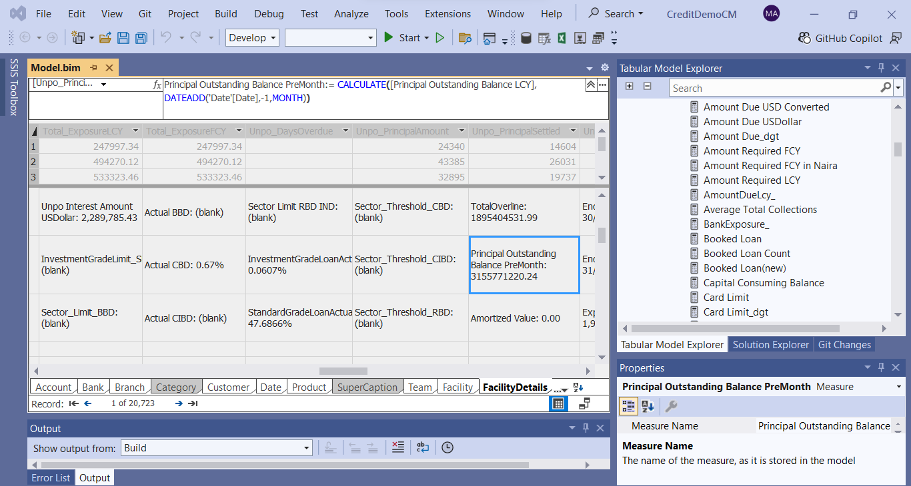

# Technical implementation evidence

[Back to README](../README.md)

## SQL Server warehouse
The supplied SQL export defines fact and dimension tables, audit fields, EDW views and stored procedures. Dimension loads include cleansing and MERGE-based upserts. The public SQL example is **illustrative and sanitised**, not a complete runnable export.

## SSAS Tabular model
The deployed model connects the warehouse to Power BI. These screenshots document model tables and relationships; relationship direction/cardinality should be verified against the source model if discussed in interviews.

## DAX measures

## KPI checks
[Read-only SQL reconciliation queries](../sql/kpi-reconciliation.sql) compare four headline measures for 1 November 2026 with the rounded Power BI cards. This is not a complete DAX or data-quality audit.

## Publication scope
The original 521 KB SQL export, database backups, PBIX/BIM files and row-level customer data are not included. The screenshots should receive a final human review before public publication.
